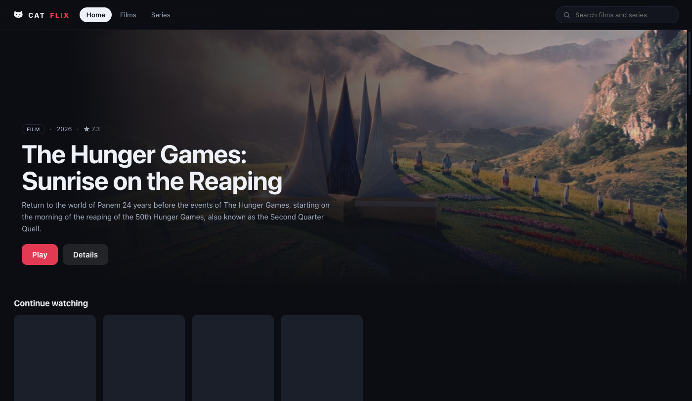

# Catflix

A native desktop streaming app for macOS: browse the Catflix catalogue, read about a title, pick
an episode and watch — in the app, with no ads, no pop-ups and no sponsor banners.



## What it does

- **Catalogue** — home rails, genre browsing and search, with posters and ratings.
- **Details** — overview, cast, seasons and episodes.
- **Player** — HLS via `hls.js` with quality, audio and subtitle tracks, resume where you left
  off, next episode, and keyboard shortcuts (`space`/`k` play, `←`/`→` seek, `↑`/`↓` volume,
  `f` fullscreen, `m` mute, `esc` back).
- **No ads** — the app loads only the catalogue and playback API, never an ad slot, pop-under or
  sponsored pre-roll.
- **Local** — watch progress and preferences stay on the machine.

Built with Tauri 2 and SolidJS, so it is a small, fast desktop app rather than a browser tab.

## How it works

`src/lib/api.ts` is the only module that talks to the network. It calls the catalogue and
playback API on interchangeable hosts, failing over between them when one is down or rate
limited and remembering the last one that worked. Playback asks `/api/stream` for sources
and hands the HLS playlist to the player; links are refreshed before they expire. The full
endpoint list is in [`docs/api.md`](docs/api.md).

Progress, preferences and the remembered host live in local storage — nothing else is sent
anywhere.

## Requirements

- macOS (the Tauri shell is configured for it), Node 20+ and a Rust toolchain with Xcode
  command line tools.

## Running

```sh
npm install
npm run tauri dev
```

Built app:

```sh
npm run tauri build
# app:  src-tauri/target/release/bundle/macos/Catflix.app
# dmg:  src-tauri/target/release/bundle/dmg/Catflix_0.1.0_aarch64.dmg
```

The icon is generated by `python3 tools/make_icon.py`, followed by `npx tauri icon app-icon.png`.

## Notes

- Metadata and artwork come from TMDB; films and series belong to their rights holders.
- If no source is available for a title, the player says so and offers to try again.
- The API hosts live in one array in `src/lib/api.ts`; everything else about the app is
  Catflix's own — the UI, navigation, player and layout.
